# Qixapay

> **Working name.** A stablecoin-backed dollar account for businesses: receive USDC, hold a dollar balance, cash out to naira, pay out on-chain, and spend on a card, with bank-grade bookkeeping underneath.

| | |
|---|---|
| **Status** | Pre-alpha. Design complete, implementation starting (Slice 0) |
| **Services** | `core-banking-engine`, `chain-gateway-engine`, `payment-orchestrator-engine`, `card-payment-engine` |
| **Languages** | Java (three services), Go (one service) |
| **Goal** | A production-style reference build of a stablecoin payments platform, designed and documented as one product |
| **Environments** | Local (Docker Compose and Anvil), then Kubernetes |

---

## Table of contents

1. [Why this exists](#1-why-this-exists)
2. [What the product does](#2-what-the-product-does)
3. [Scope, honesty and non-goals](#3-scope-honesty-and-non-goals)
4. [Architecture at a glance](#4-architecture-at-a-glance)
5. [The services in detail](#5-the-services-in-detail)
6. [Ledger and accounting](#6-ledger-and-accounting)
7. [Core flows](#7-core-flows)
8. [Reliability patterns](#8-reliability-patterns)
9. [Security and compliance](#9-security-and-compliance)
10. [Observability](#10-observability)
11. [Runtime and deployment](#11-runtime-and-deployment)
12. [Repository layout](#12-repository-layout)
13. [Technology stack](#13-technology-stack)
14. [Getting started](#14-getting-started)
15. [Testing strategy](#15-testing-strategy)
16. [Conventions](#16-conventions)
17. [Roadmap](#17-roadmap)
18. [Glossary](#18-glossary)
19. [References](#19-references)
20. [Open decisions, contributing and license](#20-open-decisions-contributing-and-license)

---

## 1. Why this exists

Businesses in Nigeria that earn or spend dollars (agencies exporting services, importers, SaaS teams paying remote contractors, marketplaces paying out sellers) run into the same problems:

- Dollars are hard to obtain at a predictable rate.
- Cross-border transfers are slow and fee-heavy.
- Dollar cards decline or have low limits.
- Counterparties abroad find it awkward to pay or receive naira.

Stablecoins fix speed and cost, but raw crypto creates new problems for a finance team: no books, no audit trail, no naira exit, a real risk of sending to the wrong address, and compliance exposure.

**Qixapay is the missing layer:** a dollar account backed by stablecoins, with a double-entry ledger, naira in and out, on-chain payouts, and a card, all reconcilable end to end.

## 2. What the product does

| Journey | What happens |
|---|---|
| **Onboard** | A business signs up, passes KYC at a tier that sets its limits, and receives an account with a dollar balance and deposit addresses |
| **Receive** | A client sends USDC to a deposit address. The system detects it, waits according to a finality policy, screens it, and credits the balance |
| **Hold** | The balance lives in a double-entry ledger. Every spend reserves funds first (a hold) and only becomes final when the outside world confirms |
| **Cash out** | The customer gets a quote, confirms, and receives naira in a bank account. The USD is held, naira is paid, and the hold settles |
| **Pay out** | The customer sends USDC to any address. The payout is screened, signed with a key that never leaves the KMS, broadcast, tracked to finality, and settled |
| **Spend** | A dollar card authorizes in real time against the balance, then clears and settles later |
| **Operate** | Reconciliation proves that chain, ledger, and bank agree. Statements, webhooks, and an ops review queue cover the rest |

End to end:

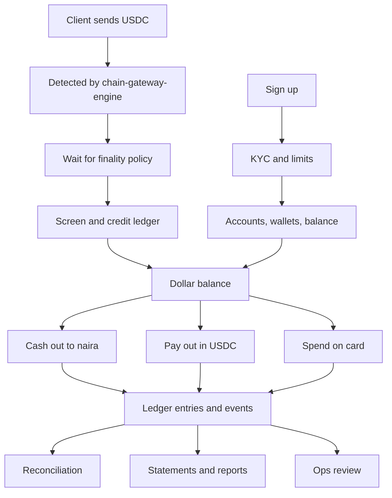

## 3. Scope, honesty and non-goals

This is a **learning and portfolio build**, designed the way a real platform would be.

- **Simulated:** the bank rail, the card network, and the KYC and sanctions vendors. Chains run on a local Anvil node and public testnets.
- **Not production, not licensed.** A real launch needs regulatory approval, banking partners, and an issuer-processor arrangement.
- **Non-goals:** retail custody, trading, DeFi, writing smart contracts, and supporting every chain. Contract code is read, not written, beyond test fixtures.

## 4. Architecture at a glance

### Design principles

1. **One writer for money.** Only `core-banking-engine` writes the ledger. Every other service asks it to.
2. **Name services after what they own.** A name states a boundary, not an activity.
3. **Hold, then settle.** Reserve money before anything external happens. Make it final only when the outside world confirms.
4. **Never retry blindly.** When the outcome of an external call is unknown, persist what you attempted, query the real status, and reconcile.
5. **Everything is idempotent.** Every write carries an idempotency key, and every event consumer tolerates duplicates.
6. **The chain is untrusted until final.** Detected is not credited. Credited is not final.
7. **Least privilege for keys.** One role may sign. Nothing else can reach the signer.
8. **Synchronous for decisions, asynchronous for facts.** Calls where the caller needs an answer now are API calls. Everything that merely happened is an event.

### The services

| Service | Language | Owns | Database |
|---|---|---|---|
| `core-banking-engine` | Java | Accounts, double-entry ledger, holds, deposit crediting, payout orders, compliance screening, identity and KYC | `core_banking` |
| `chain-gateway-engine` | Go | Everything that reads from or writes to a blockchain: scanning, reorg handling, finality, deposit addresses, nonces, fees, signing requests, broadcast, fee bumps | `chain_gateway` |
| `payment-orchestrator-engine` | Java | Quotes, cash-out sagas, treasury and float, bank adapter | `payment_orchestrator` |
| `card-payment-engine` | Go | Card state, ISO 8583 gateway, authorization, clearing, capture | `card_payment` |

Supporting components:

| Component | Role |
|---|---|
| `edge-api` | Public API gateway and BFF: authentication, rate limits, `Idempotency-Key` enforcement, routing |
| `event-workers` | Event-driven consumers: webhooks, notifier, reconciler, reporting |
| `bank-simulator` | Simulated naira bank rail with configurable chaos (delays, duplicates, timeouts) |
| `card-network-simulator` | Simulated card network that sends ISO 8583 authorizations, reversals, and clearing files |

### System context

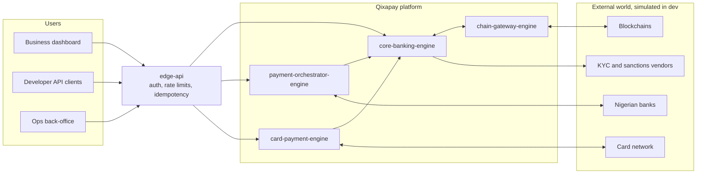

### Container view

Solid lines are synchronous calls. Dashed lines are asynchronous events.

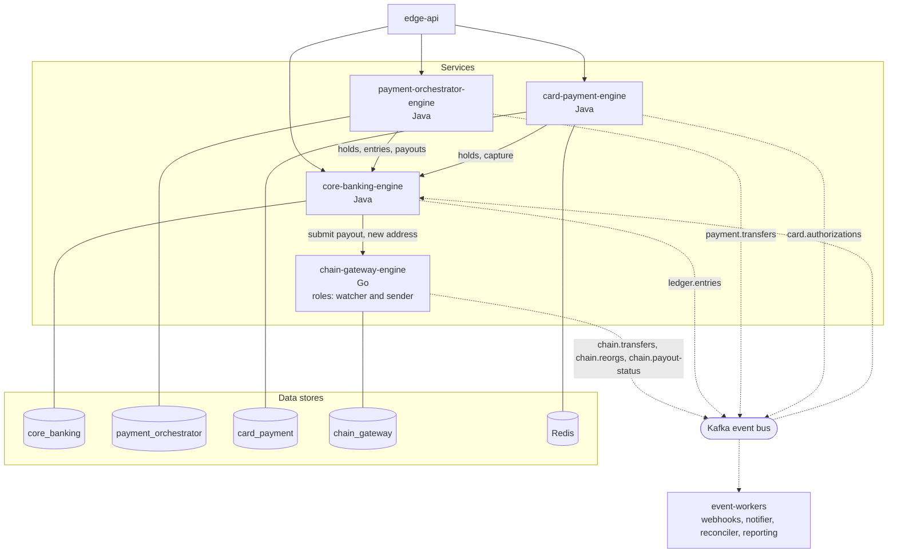

### Communication contracts

**Asynchronous events (Kafka-compatible broker).** Only the producer writes to a topic. Topics are versioned so schemas can evolve without breaking consumers.

| Topic | Producer | Consumers | Purpose |
|---|---|---|---|
| `chain.transfers.v1` | `chain-gateway-engine` | `core-banking-engine`, `event-workers` | Detected transfers with a finality label (`tentative`, `safe`, `final`) |
| `chain.reorgs.v1` | `chain-gateway-engine` | `core-banking-engine` | Blocks and transfers removed by a reorg |
| `chain.payout-status.v1` | `chain-gateway-engine` | `core-banking-engine` | Payout progress and the actual network fee |
| `ledger.entries.v1` | `core-banking-engine` | `event-workers` | Posted journal entries |
| `payment.transfers.v1` | `payment-orchestrator-engine` | `event-workers` | Cash-out and corridor progress |
| `card.authorizations.v1` | `card-payment-engine` | `event-workers` | Authorization decisions and clearing results |

**Synchronous APIs.** Internal paths are never exposed publicly. Public paths are served through `edge-api`.

| Service | Endpoint | Purpose |
|---|---|---|
| `core-banking-engine` | `POST /internal/v1/holds` | Reserve funds against an account |
| `core-banking-engine` | `POST /internal/v1/holds/{id}/capture` | Turn a hold into a final entry |
| `core-banking-engine` | `POST /internal/v1/holds/{id}/release` | Free a hold |
| `core-banking-engine` | `POST /internal/v1/entries` | Post a balanced journal entry |
| `core-banking-engine` | `POST /v1/payouts` (public) | Request an on-chain payout |
| `core-banking-engine` | `GET /v1/accounts/{id}/balance` (public) | Read balances |
| `chain-gateway-engine` | `POST /internal/v1/addresses` | Derive and watch a new deposit address |
| `chain-gateway-engine` | `POST /internal/v1/chain-payouts` | Submit a payout for signing and broadcast |
| `chain-gateway-engine` | `GET /internal/v1/chain-payouts/{payout_id}` | Query payout state (used to resolve unknown outcomes) |
| `payment-orchestrator-engine` | `POST /v1/quotes` (public) | Request a cash-out quote |
| `payment-orchestrator-engine` | `POST /v1/cashouts` (public) | Confirm a cash-out |
| `card-payment-engine` | `POST /v1/cards`, `POST /v1/cards/{id}/freeze` (public) | Card lifecycle |
| `card-payment-engine` | ISO 8583 TCP listener | Authorization, reversal, and clearing messages from the network |

Every `POST` that changes state requires an `Idempotency-Key` header. A repeated key returns the original result. A reused key with a different body is rejected.

**Event envelope.** Every event uses the same wrapper, and `correlation_id` travels through every call and event so one customer action can be traced across all services:

```json
{
  "event_id": "evt_example",
  "type": "chain.transfers.v1",
  "correlation_id": "corr_example",
  "occurred_at": "2026-10-31T10:15:30Z",
  "payload": {
    "chain_id": 11155111,
    "block_number": 100,
    "block_hash": "0xBLOCK_HASH",
    "tx_hash": "0xTX_HASH",
    "log_index": 7,
    "token": "0xUSDC_CONTRACT",
    "from": "0xSENDER",
    "to": "0xDEPOSIT_ADDRESS",
    "amount": "250000000",
    "decimals": 6,
    "finality": "tentative"
  }
}
```

Amounts are strings in the token's smallest unit (6 decimals for USDC, so `250000000` is 250 USDC). Money is never a floating-point number.

## 5. The services in detail

### 5.1 `core-banking-engine` (Java, Spring Boot)

**The only service that writes the ledger.** It records money, decides whether money may move, and never touches a blockchain, a bank, or a card network directly.

| Module | Responsibility |
|---|---|
| `ledger` | Immutable double-entry journal, account balances, balance checks |
| `holds` | Reserve, capture, and release funds. The shared primitive for cash-out, payout, and card flows |
| `deposits` | Consume `chain.transfers.v1` and `chain.reorgs.v1`, apply the credit policy, post or reverse credits |
| `payout-orders` | Validate payout requests, place holds, submit to `chain-gateway-engine`, settle or release on status events |
| `compliance` | Address screening, sanctions checks, limits, velocity rules, case flags |
| `identity` | Organizations, users, API keys, KYC status, tiered limits |
| `kyc-adapter` | Wraps the (simulated) KYC and sanctions vendor APIs |

**Does not:** sign transactions, talk to RPC nodes, call a bank, or parse card messages.

**Design notes**

- Module boundaries are enforced in code (separate packages, no cross-module database access, an architecture test that fails the build on violations). This keeps the option to split a module out later.
- Balances are derived from ledger lines. Nothing updates a balance in place.
- Concurrency: two simultaneous spends must not both pass a balance check. Use row locks on the account or optimistic versioning, and prove it with a concurrent test.
- If a payout has no status after a timeout, the service queries `chain-gateway-engine` by `payout_id` rather than waiting forever.

### 5.2 `chain-gateway-engine` (Go)

**Everything that reads from or writes to a blockchain.** It knows addresses, amounts, and transaction hashes. It never knows whose money it is.

It runs from one codebase as **two roles**, deployed separately with different privileges:

| Role | Does | Privileges |
|---|---|---|
| `watcher` | Scans blocks, detects transfers, checks for reorgs, labels finality, publishes events | Read-only RPC. No access to the signer |
| `sender` | Allocates nonces, estimates fees, requests signatures, saves and broadcasts transactions, replaces stuck ones, tracks to finality | Broadcast RPC and the **only** identity allowed to call the KMS signer |

| Package | Responsibility |
|---|---|
| `rpc` | Provider pool: failover, rate limiting, retries, timeouts |
| `scan` | The scan loop, parent-hash check, walk-back |
| `decode` | ERC-20 `Transfer` decoding and the token allowlist |
| `finality` | Promotes rows from `tentative` to `safe` to `final` using the node's block tags |
| `addresses` | HD address derivation and the watch list |
| `txmanager` | Nonce allocation, fee estimation, signing requests, fee-bump replacement |
| `broadcaster` | Persist the signed transaction first, then send |
| `store` | Postgres access and transaction helpers |
| `outbox` | Relay of queued events to Kafka |
| `api` | Internal REST or gRPC endpoints |

**Design notes**

- The sender enforces its own caps (per-transaction and daily limits), so a compromised caller still cannot drain the hot wallet.
- Payout reports include the actual fee paid, so `core-banking-engine` can book the network cost.
- Adding another chain (for example Tron or Solana) changes only this service.

### 5.3 `payment-orchestrator-engine` (Java, Spring Boot)

**Decides and orchestrates multi-step payments.** It runs the saga for a cash-out but never records money itself: it asks `core-banking-engine` to.

| Module | Responsibility |
|---|---|
| `quotes` | Rate source, spread, fee, expiry. Quotes are immutable once issued |
| `cashouts` | Persisted saga and state machine: quote, hold, bank transfer, settle or refund |
| `treasury` | Tracks float (naira and stablecoin) and open FX exposure, triggers rebalancing and card float top-ups |
| `bank-adapter` | Talks to the bank rail. Unique reference per transfer, status queries, callback handling |

**Design notes**

- Saga state is persisted after every step so a crash resumes instead of losing a transfer.
- An unknown bank outcome is never retried blindly. Query status, then resolve.
- Money arithmetic uses `BigDecimal` or integer minor units, never floating point.

### 5.4 `card-payment-engine` (Java, Spring Boot)

**Turns card network messages into approve or decline decisions, then into ledger entries.**

| Module | Responsibility |
|---|---|
| `gateway` | ISO 8583 listener, message parsing, duplicate detection |
| `authorization` | Ordered checks (cheap first), response codes, hold creation |
| `clearing` | Parse clearing files, match to holds, handle amount differences |
| `cards` | Card state: active, frozen, expired. Limits and merchant category rules |
| `float` | Card float position and settlement obligations |

**Design notes**

- Authorization is real time and must answer inside the network's window. Cheap checks run first, velocity counters live in Redis, and the hold is one atomic call to `core-banking-engine`.
- Clearing is batch. Amounts can differ from the authorization (tips, currency conversion, fuel pre-authorization), so capture handles different, partial, and multiple clearings.
- A real launch would normally integrate with an issuer-processor that delivers authorization decisions by API instead of raw ISO 8583. The simulator teaches the same decision logic and message handling.
- ISO 8583 library choice is an open decision: jPOS is the standard Java option but is licensed under AGPLv3 with a separate commercial license. See [Open decisions](#20-open-decisions-contributing-and-license).

### 5.5 Supporting components

- **`edge-api`:** authenticates callers (API keys for developers, tokens for the dashboard), applies rate limits, enforces `Idempotency-Key`, and routes to services.
- **`event-workers`:** consumes events to deliver signed webhooks with retries, send notifications, produce statements, and run the three-way reconciler.
- **`bank-simulator` and `card-network-simulator`:** deterministic, configurable stand-ins for the outside world, including failure modes.

## 6. Ledger and accounting

### Chart of accounts (simplified)

| Account | Type | Meaning |
|---|---|---|
| `customer:{id}:available` | Liability | What the platform owes the customer and they can spend |
| `customer:{id}:held` | Liability | The part of their balance reserved for an in-flight transaction |
| `platform:wallet:USDC` | Asset | USDC in platform wallets |
| `platform:bank:NGN` | Asset | Naira in the settlement bank account |
| `platform:card_float:USD` | Asset | Prefunded money backing card settlement |
| `platform:network_payable:USD` | Liability | Owed to the card network for cleared purchases |
| `platform:fx_position:USD` and `:NGN` | Position | Bridge accounts for conversions, showing open FX exposure |
| `platform:fees` | Revenue | Fees earned |

### Rules

1. Every journal entry balances: debits equal credits, **per currency**.
2. Entries are immutable. Corrections are new entries (reversals), never edits.
3. Balances are derived from ledger lines, never stored and updated in place.
4. Each entry has a unique idempotency key. Replaying the same request posts nothing new.
5. Money is stored as integer minor units or fixed-scale decimals.

### Data model

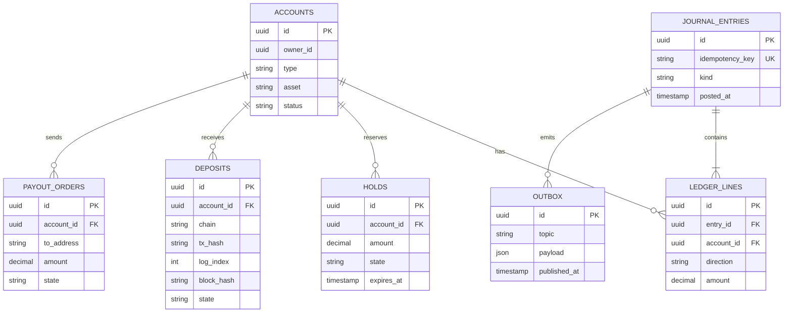

### Entries by flow

All numbers are illustrative. For each flow, debits equal credits.

**Deposit** (250 USDC received):

| When | Debit | Credit |
|---|---|---|
| Credited | `platform:wallet:USDC` 250 | `customer:available` 250 |
| Reorged out (reversal) | `customer:available` 250 | `platform:wallet:USDC` 250 |

**On-chain payout** (customer sends 100 USDC, fee 1):

| When | Debit | Credit |
|---|---|---|
| Hold placed | `customer:available` 101 | `customer:held` 101 |
| Final, settled | `customer:held` 101 | `platform:wallet:USDC` 100 and `platform:fees` 1 |
| Failed, released | `customer:held` 101 | `customer:available` 101 |

The network fee is paid in the chain's native token. It is booked separately using the fee reported in the final status event.

**Cash-out** (1 USD = 1,500 NGN, customer withdraws 100 USD, fee 1 USD, naira paid 99 x 1,500 = 148,500):

| When | Debit | Credit |
|---|---|---|
| Hold placed | `customer:available` 100 USD | `customer:held` 100 USD |
| Settled, USD side | `customer:held` 100 USD | `fx_position:USD` 99 USD and `platform:fees` 1 USD |
| Settled, NGN side | `fx_position:NGN` 148,500 NGN | `platform:bank:NGN` 148,500 NGN |
| Failed or expired | `customer:held` 100 USD | `customer:available` 100 USD |

The USDC wallet is untouched, because the platform keeps the USDC and pays out its own naira. The two position accounts together show open FX exposure, which treasury rebalances.

**Card purchase** (50 USD):

| When | Debit | Credit |
|---|---|---|
| Authorized | `customer:available` 50 | `customer:held` 50 |
| Captured at clearing | `customer:held` 50 | `platform:network_payable` 50 |
| Settled with the network | `platform:network_payable` 50 | `platform:card_float` 50 |
| Reversed or expired | `customer:held` 50 | `customer:available` 50 |
| Refund after settlement (20) | `platform:card_float` 20 | `customer:available` 20 |
| Float top-up (500, via payout) | `platform:card_float` 500 | `platform:wallet:USDC` 500 |

## 7. Core flows

### 7.1 Onboarding and KYC

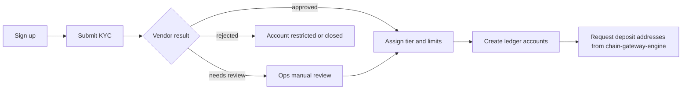

Tiers set limits that compliance checks apply to every payout and cash-out. Illustrative defaults (all configurable):

| Tier | Requirement | Capability |
|---|---|---|
| 0 | Email verified | No money movement |
| 1 | Basic business details | Low limits |
| 2 | Full business documents | Standard limits |
| 3 | Enhanced due diligence | High limits |

### 7.2 Receive USDC (deposit)

On-chain, USDC is a smart contract that keeps a table of address to balance. The sender's wallet signs a call to the contract's `transfer(to, amount)` function and pays network fees in the chain's native token. Nothing is "delivered" to the recipient: the contract's table changes and a `Transfer` event is recorded. The deposit address is unique per customer, so the address itself says whose deposit it is.

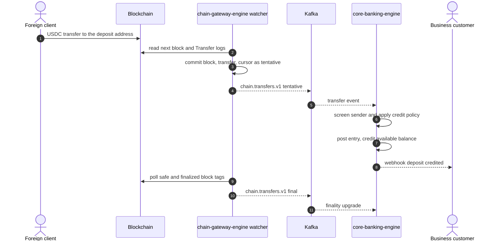

**Credit policy.** Finality is a risk decision. The longer you wait, the safer you are and the slower the customer experience. Illustrative tiers (configurable per chain):

| Deposit size | Credit when | Trade-off |
|---|---|---|
| Small | `tentative` (a few confirmations) | Fast, small exposure if a reorg happens |
| Medium | `safe` | A few minutes, very low reorg risk |
| Large | `final` | Roughly a quarter of an hour on Ethereum, effectively no reorg risk |

If the platform credits before finality, it takes the reorg risk on itself. That is a business decision and should be documented as one.

Deposit state in `core-banking-engine`:

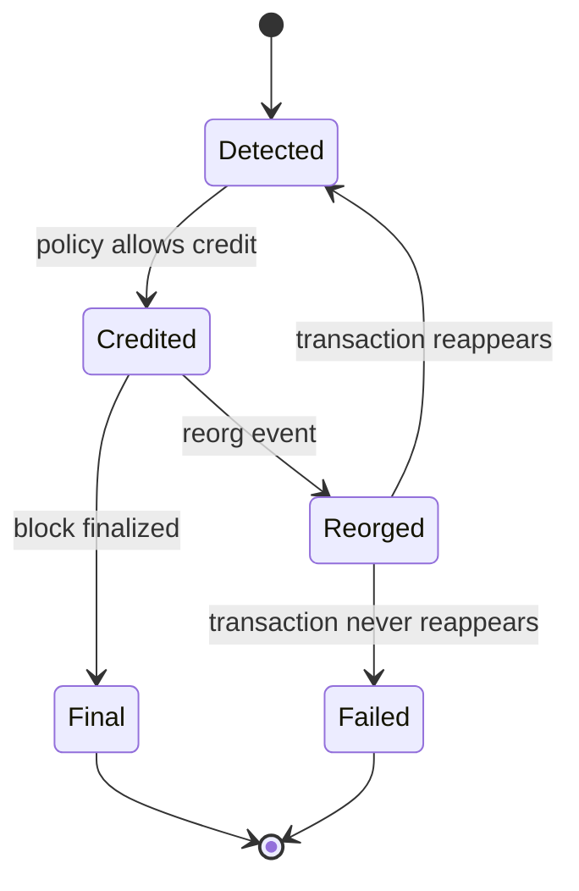

Credits are deduplicated per inclusion, with the key `(chain, tx_hash, log_index, block_hash)`. If a reorg removes a transaction and it later reappears in a different block, it is credited once for that new inclusion.

### 7.3 Chain scanning, reorgs and finality

A **reorg** happens when two validators produce competing blocks at the same height and the network settles on one branch. Blocks on the abandoned branch are orphaned. The indexer may already have recorded them, so it must detect this and repair its data.

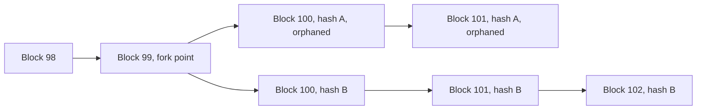

**The reorg check is one rule:** the next block is accepted only if its `parentHash` equals the hash of the last committed block (the cursor). If not, the chain the indexer was following is no longer the chain the node reports.

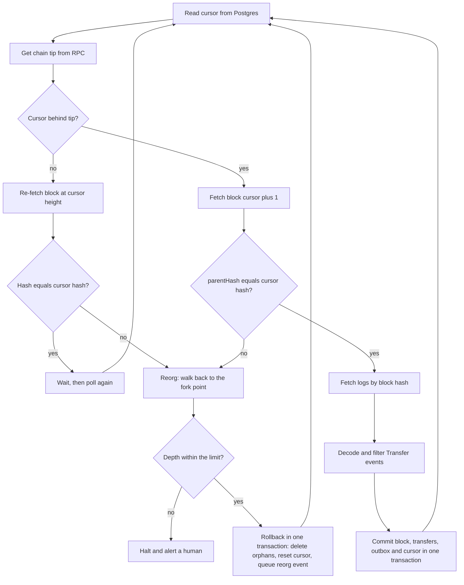

**Why each detail matters**

- **Fetch logs by block hash, not number.** If the chain changes between the block fetch and the log fetch, asking by number can return logs from a different block.
- **One transaction per commit.** The block, its transfers, outbox events, and the new cursor are written together, so a crash can never leave the cursor ahead of the data.
- **Never skip ahead.** The loop only fetches `cursor + 1`. A gap would silently lose deposits.
- **Check even when there is no new block.** If the chain moves to a branch that is not longer, the tip may equal the cursor height and the parent check never fires, so re-fetch the block at the cursor height and compare hashes.
- **Depth limit.** If the walk-back goes deeper than anything plausible, stop and alert. Never rewrite deep history on a guess.

**Worked example.** The database holds blocks 98, 99, and 100 (hash `A100`), and a deposit transaction `T1` sits in block 100. The chain reorganizes.

1. The indexer fetches block 101, whose parent is `B100`, but the cursor holds `A100`. The check fails.
2. It walks back, comparing stored and canonical hashes. At 100, `A100` differs from `B100`. At 99, `A99` equals `A99`, so block 99 is the fork point.
3. In one transaction it deletes blocks above 99 (transfers go with them through a cascade), resets the cursor to 99, and queues a `chain.reorgs.v1` event listing what was removed.
4. The loop resumes from 99, fetches the new block 100 and 101, and records `T1` again in its new block.

**Rollback in SQL:**

```sql
BEGIN;
-- 1. capture what is about to disappear, for the event payload
SELECT block_hash, log_index, tx_hash, to_addr, amount
  FROM transfers
 WHERE chain_id = $1
   AND block_hash IN (SELECT hash FROM blocks WHERE chain_id = $1 AND number > $2);
-- 2. delete orphaned blocks (transfers go via ON DELETE CASCADE)
DELETE FROM blocks WHERE chain_id = $1 AND number > $2;
-- 3. reset the cursor to the fork point
UPDATE cursors
   SET number = $2,
       hash   = (SELECT hash FROM blocks WHERE chain_id = $1 AND number = $2)
 WHERE chain_id = $1;
-- 4. queue the event in the same transaction
INSERT INTO outbox (topic, payload) VALUES ('chain.reorgs.v1', $3);
COMMIT;
```

**Reorg event payload:**

```json
{
  "chain_id": 11155111,
  "fork_point": 99,
  "removed_blocks": [{ "number": 100, "hash": "0xA100" }],
  "removed_transfers": [
    { "tx_hash": "0xT1", "log_index": 7, "to": "0xX", "amount": "250000000" }
  ]
}
```

**Finality.** A block is final when it can no longer be reverted. Ethereum's node API exposes this through block tags: `latest` (newest, can still reorg), `safe` (justified, very unlikely to reorg), and `finalized` (cannot be reverted). A finality promoter runs on a timer, reads the `safe` and `finalized` numbers, and upgrades stored rows. Finality times differ per chain and per layer-2, so thresholds and depth limits are set per chain.

**Core data model of `chain-gateway-engine`:**

```sql
CREATE TABLE blocks (
  chain_id    BIGINT NOT NULL,
  number      BIGINT NOT NULL,
  hash        BYTEA  NOT NULL,
  parent_hash BYTEA  NOT NULL,
  finality    TEXT   NOT NULL DEFAULT 'tentative',
  PRIMARY KEY (chain_id, hash),
  UNIQUE (chain_id, number)
);

CREATE TABLE transfers (
  chain_id   BIGINT NOT NULL,
  block_hash BYTEA  NOT NULL,
  log_index  INT    NOT NULL,
  tx_hash    BYTEA  NOT NULL,
  token      BYTEA  NOT NULL,
  from_addr  BYTEA  NOT NULL,
  to_addr    BYTEA  NOT NULL,
  amount     NUMERIC(78,0) NOT NULL,
  PRIMARY KEY (chain_id, block_hash, log_index),
  FOREIGN KEY (chain_id, block_hash)
    REFERENCES blocks (chain_id, hash) ON DELETE CASCADE
);
CREATE INDEX ON transfers (chain_id, to_addr);

CREATE TABLE cursors (
  chain_id BIGINT PRIMARY KEY,
  number   BIGINT NOT NULL,
  hash     BYTEA  NOT NULL
);

CREATE TABLE outbox (
  id           BIGSERIAL PRIMARY KEY,
  topic        TEXT  NOT NULL,
  payload      JSONB NOT NULL,
  published_at TIMESTAMPTZ
);
```

`NUMERIC(78,0)` is wide enough for a full `uint256` token amount.

**Detecting a transfer.** The indexer asks the node for logs of one block by hash, filtered to the USDC contract (`address`), the `Transfer(address,address,uint256)` event signature (`topics[0]`), and one of the platform's deposit addresses as the recipient (`topics[2]`). The sender is in `topics[1]` and the amount is in the log's `data`. A transfer is uniquely identified by its block hash and log index.

**Core scan interfaces (Go):**

```go
type BlockSource interface {
    Tip(ctx context.Context) (uint64, error)
    BlockByNumber(ctx context.Context, n uint64) (Header, error)
    TransferLogs(ctx context.Context, blockHash Hash) ([]Log, error)
    FinalizedNumber(ctx context.Context) (uint64, error)
}

type Store interface {
    Cursor(ctx context.Context) (Cursor, error)
    BlockHashAt(ctx context.Context, n uint64) (Hash, bool, error)
    Commit(ctx context.Context, b Header, t []Transfer, next Cursor) error
    Rollback(ctx context.Context, forkPoint uint64) error
}
```

Small interfaces keep the reorg logic testable against an in-memory fake chain.

### 7.4 Cash out to naira

Preconditions: the customer's KYC tier allows the amount, the destination bank account was verified with a name enquiry, and the naira float can cover it.

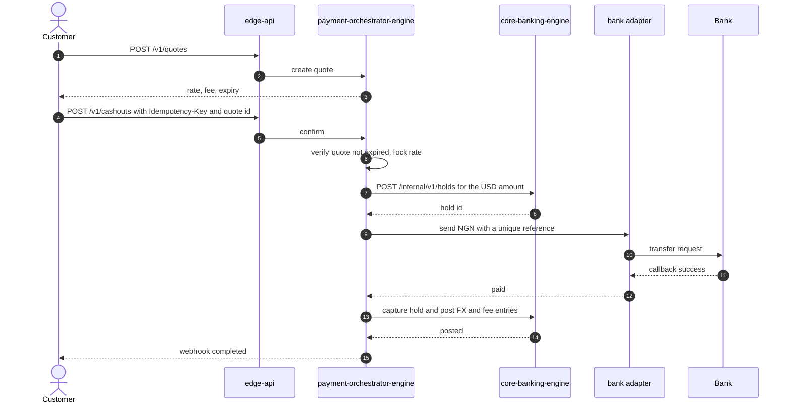

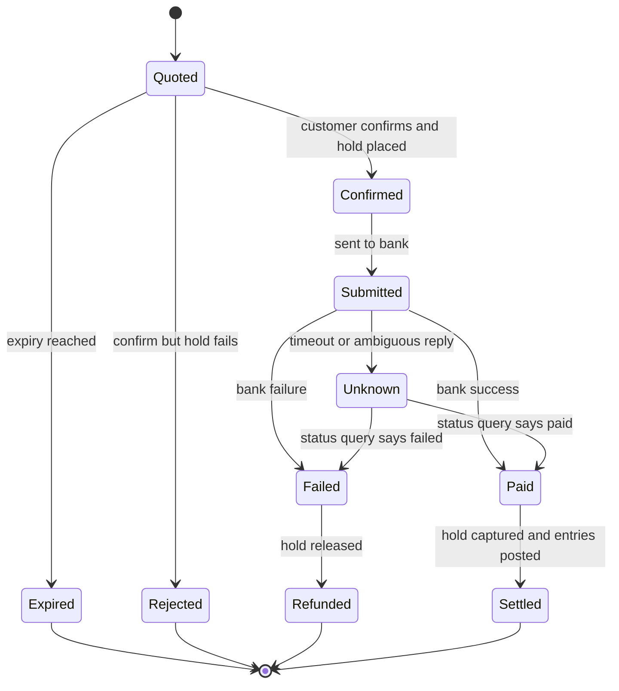

`Unknown` is the state that separates amateur from production systems. If the bank call times out, the money may or may not have moved. The only safe response is to keep the hold, query the bank's transaction status using the unique reference, and resolve to `Paid` or `Failed` from the answer. After a set number of failed status checks, escalate to a human with the whole record attached.

| Situation | Behavior |
|---|---|
| Quote expires before confirm | Reject, issue a new quote, never honor a stale rate |
| Same confirm sent twice | Idempotency key returns the original result, no second hold |
| Bank callback arrives twice or out of order | State machine ignores transitions that no longer apply |
| Callback arrives after a timeout was escalated | Apply it idempotently, close the manual case |
| Bank later returns the credit | Post compensating entries, re-credit the customer, alert ops |
| Naira float runs low | Pause new cash-outs, alert treasury, rebalance |
| Name enquiry does not match | Block the destination until reviewed |

### 7.5 On-chain payout

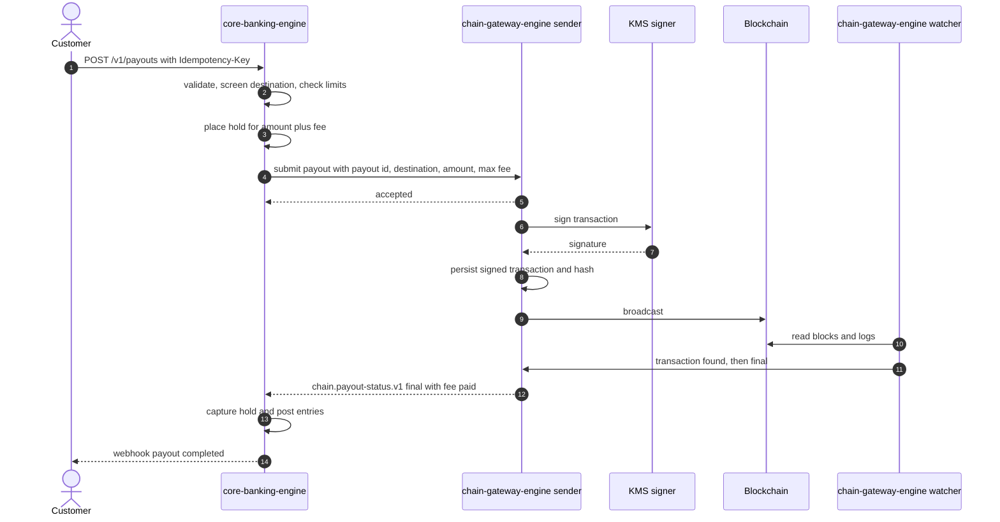

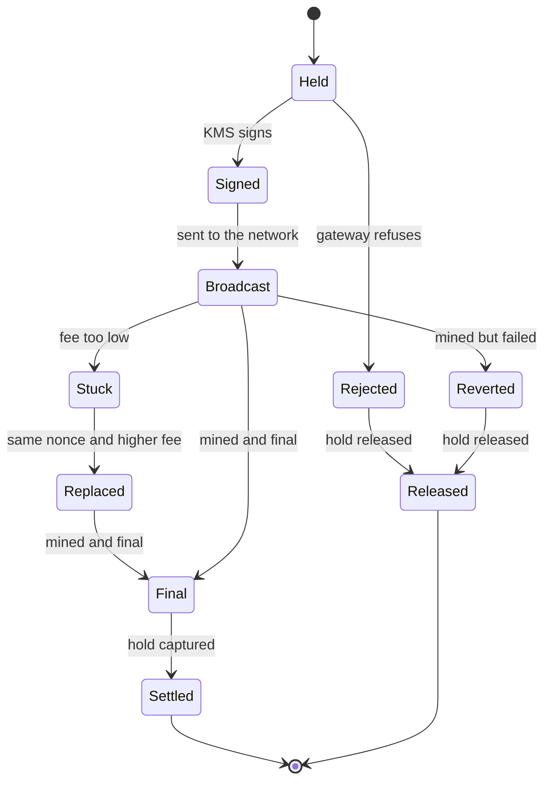

**Engineering details**

- **Validate first.** Address format and checksum, network match, minimum amount, KYC limits. Larger business payouts can require a second approver (maker-checker).
- **Screen before holding.** A destination that fails screening is rejected before any hold exists and flagged for ops.
- **Save, then broadcast.** The signed transaction and its hash are persisted before sending. After a crash, the same transaction can be re-broadcast safely because the network ignores duplicates of an identical signed transaction.
- **Nonces.** Each sending address needs strictly sequential nonces. Allocate them in the database inside a transaction, serialize signing per address, and handle gaps so one failed transaction does not block those behind it.
- **Fees.** Set a maximum fee and priority tip from current network conditions. The caller supplies a `max_fee` cap and the sender never exceeds it.
- **Stuck transactions.** Resend with the same nonce and a meaningfully higher fee. Only one of the two can be mined, so there is no risk of paying twice.
- **Reverted transactions.** A mined transaction can still fail. Release the hold, alert ops, and record the gas that was spent.
- **Two customer-facing statuses.** "Sent" at broadcast, "completed" only at the finality threshold. Larger payouts wait for the stronger signal.
- **Hot wallet limits.** Keep only what is needed, top up from cold storage, and pause payouts automatically when balance or anomaly thresholds trip.

| Situation | Behavior |
|---|---|
| Same request sent twice | Idempotency key returns the original payout |
| Address fails screening | Reject before the hold, flag for ops |
| Wrong network for the address | Reject if detectable, warn clearly in the UI |
| Broadcast call times out | Look up the saved transaction hash on the node before retrying |
| Transaction stuck | Fee-bump replacement with the same nonce |
| Transaction reverts on-chain | Release the hold, alert, record the gas cost |
| Reorg removes the transaction before finality | Watcher notifies the sender, which re-broadcasts or fails the payout |
| Hot wallet too low | Queue or pause payouts, alert treasury |
| No status after the timeout | `core-banking-engine` queries the gateway by `payout_id` |

### 7.6 Card payments

Two phases with very different timing: a real-time **authorization** (under a couple of seconds) and a batch **clearing and settlement** that follows hours or days later.

**Phase 1: authorization.** In ISO 8583 terms, `0100` is the authorization request and `0110` is the response. The decision travels in field 39 as a response code.

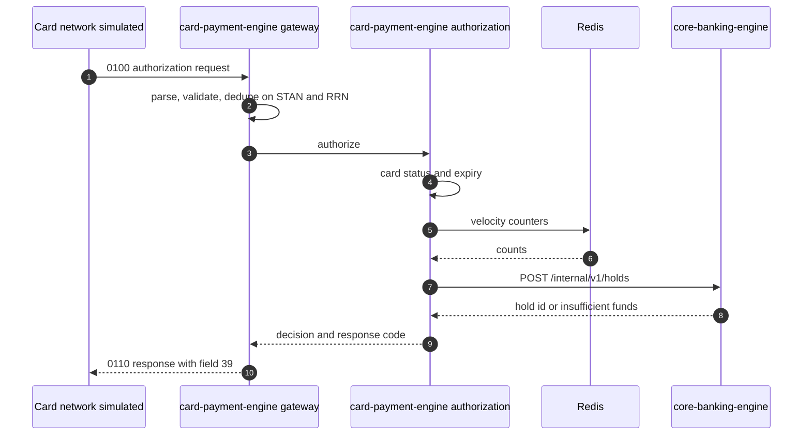

Checks run in order, cheapest first, and the first failure ends the flow:

| Order | Check | Outcome on failure |
|---|---|---|
| 1 | Parse and validate the message | Decline `30` (format error) |
| 2 | Duplicate check on STAN and RRN | Replay the original response, no second hold |
| 3 | Card status and expiry | Decline `14` (invalid card) or `54` (expired) |
| 4 | Available balance and limits | Decline `51` (insufficient funds) |
| 5 | Velocity and merchant category rules | Decline `05` (do not honor) |
| 6 | Create the hold (one atomic call) | Approve `00` |

If the ledger or Redis is slow or down, the engine **declines with a system code rather than approving blindly**, and alerts.

**Hold lifecycle:**

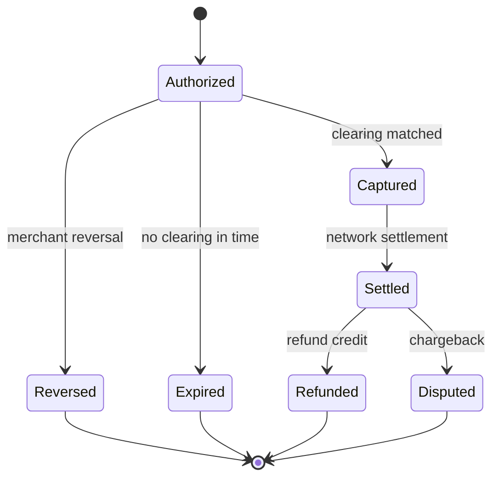

**Phase 2: clearing, settlement and float top-up.**

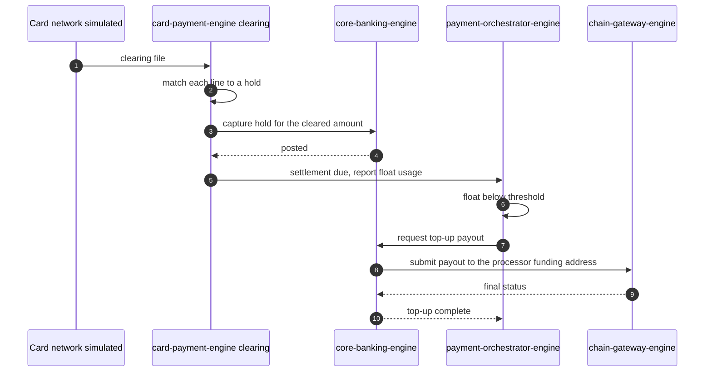

- **Capture can differ from the authorization** (tips, currency conversion, fuel pre-authorization), within a configured tolerance. Handle different, partial, and multiple clearings.
- **The platform pays the network at settlement** regardless of what happens to the customer's balance afterward. That is why holds are strict and the float is monitored as carefully as customer balances.
- **Top-up closes the loop** with the other flows: it is an on-chain payout requested through `core-banking-engine`.

| Situation | Behavior |
|---|---|
| Network retries the same authorization | Replay the original response, no second hold |
| Hold would exceed available balance | Decline `51`, no hold |
| Card expired, frozen, or unknown | Decline `54` or `14`, no hold |
| Clearing amount higher than the hold (tip) | Capture up to tolerance, flag the excess |
| Clearing arrives with no matching hold | Park for manual review, never drop silently |
| Clearing arrives after the hold expired | Capture if funds allow, else record a shortfall for ops |
| Merchant sends a reversal | Release the hold, ignore a duplicate reversal |
| Float below threshold | Alert, trigger a top-up payout, tighten approvals if critical |

### 7.7 Reconciliation

Three independent records must agree. Any difference is a **break** and opens an ops case with the conflicting records side by side.

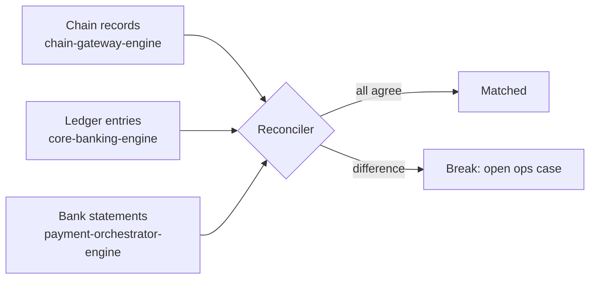

Daily jobs compare on-chain balances to ledger balances, bank statement lines to cash-out records, and card clearing lines to holds.

## 8. Reliability patterns

| Pattern | Where it applies | How it works |
|---|---|---|
| **Idempotency keys** | Every state-changing `POST` | A repeated key returns the original result. The request hash is stored so a reused key with a different body is rejected |
| **Transactional outbox** | Every service that publishes events | The business change and the event row are written in one database transaction. A relay publishes the row later, so an event is never lost and never announced for data that does not exist |
| **Hold, then settle** | Cash-out, payout, card | Reserve funds first. Settle only when the outside world confirms. Release on failure |
| **Saga with compensation** | Cash-out | Each forward step has a defined undo. State is persisted after every step so a crash resumes |
| **Unknown-outcome rule** | Bank calls, broadcasts | Persist the attempt, query the real status, never retry blindly |
| **Save, then send** | Chain broadcasts | Persist the signed transaction before sending, so re-broadcast after a crash is safe |
| **At-least-once delivery plus idempotent consumers** | All Kafka consumers | Duplicates are harmless because consumers dedupe on an event or inclusion identity |
| **Circuit breakers and pauses** | Hot wallet, naira float, card float | Automatic pause plus an alert when a balance or anomaly threshold trips |
| **Reconciliation** | Chain, ledger, bank, card clearing | Independent records compared daily. Breaks become ops cases |
| **Timeouts on every external call** | RPC, bank, KMS | No unbounded waits. A timeout is an input to the unknown-outcome rule, not a failure |

### Failure matrix

| Situation | Handling |
|---|---|
| Process crashes mid-commit | The database transaction rolls back. On restart the cursor and state are re-read and the work redone |
| Two RPC providers disagree or one lags | Parent-hash check catches inconsistency. Use one provider per scan pass and fail over only on error, with backoff |
| Node returns "block not found" for a recent block | Transient. Retry, never treat as a reorg |
| Reorg deeper than the limit | Halt and page a human |
| Duplicate Kafka delivery | Consumers are idempotent |
| Indexer falls behind | The same loop catches up block by block. A lag metric alerts |
| RPC rate limits | Fetch one block at a time by hash, back off with jitter |
| Chain stalls | Tip stops advancing. Alert on no new blocks for N minutes |
| Ledger or Redis unavailable during card authorization | Decline with a system code, alert |
| Bank rail down | Pause cash-outs, keep holds, resume with status queries |
| Reconciliation break | Open an ops case with all three records attached |

## 9. Security and compliance

### Trust boundaries

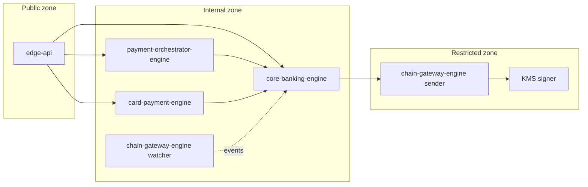

### Privilege model

| Component | Can reach | Cannot reach |
|---|---|---|
| `edge-api` | Internal service APIs | Databases, signer, RPC |
| `core-banking-engine` | Its own database, `chain-gateway-engine` API, KYC vendor | RPC nodes, signer, banks |
| `payment-orchestrator-engine` | Its own database, `core-banking-engine` API, bank rail | Ledger tables, signer |
| `card-payment-engine` | Its own database, Redis, `core-banking-engine` API, card network | Ledger tables, signer |
| `chain-gateway-engine` watcher | Read-only RPC, its own database | Signer, broadcast |
| `chain-gateway-engine` sender | Broadcast RPC, KMS signer, its own database | Customer or balance data |

### Controls

- **Key management.** Private keys live in a KMS or HSM and never in a pod's memory or a Kubernetes secret. Only the sender role's identity may call the signer. A local encrypted keystore is acceptable in development only.
- **Defense in depth.** The sender enforces its own per-transaction and daily caps even if the caller asks for more. Hot wallets hold only what is needed.
- **Service-to-service authentication.** Mutual TLS or signed service tokens between services. Internal endpoints are not routed publicly.
- **Authentication and authorization at the edge.** API keys for developers, tokens for the dashboard, per-organization scoping on every query.
- **Secrets.** Stored in a secrets manager, injected at runtime, rotated on a schedule. Never committed.
- **Audit trail.** The ledger is append-only. Every state transition records who or what caused it and the correlation ID.
- **Sensitive data.** Minimize and encrypt PII. Card data is tokenized. Never log keys, full card numbers, or personal documents.
- **Compliance screening.** Destination and source addresses are screened for sanctions and risk. Limits and velocity rules apply per KYC tier. Flagged cases go to an ops review queue. Larger transfers may need Travel Rule data, which depends on current regulation.

### Threats considered

| Threat | Mitigation |
|---|---|
| Compromised application service tries to drain funds | It cannot reach the signer. The sender has its own caps |
| Replay of a request | Idempotency keys |
| Double credit of a deposit | Inclusion-based dedupe key and append-only ledger |
| Crediting a deposit that a reorg removes | Credit policy by finality, reversal entries, reorg events |
| Double payout | Save-then-send, same-nonce replacement, status query before retry |
| Stale quote exploited | Immutable quotes with short expiry, checked at confirm |
| Float exhaustion on cards | Float monitoring, top-up automation, approval tightening |
| Sending to a wrong network | Network shown explicitly and validated, deposit-address warnings |

## 10. Observability

Every log line carries `service`, `role` (for the gateway), and `correlation_id`. Traces span the whole path from the edge to the last event consumer.

| Area | Metrics |
|---|---|
| Chain gateway | `chain_gateway_lag_blocks`, `chain_gateway_reorgs_total`, `chain_gateway_reorg_depth`, `chain_gateway_rpc_errors_total{provider}`, `chain_gateway_outbox_backlog`, `chain_gateway_time_to_final_seconds` |
| Ledger | `core_banking_holds_total{state}`, `core_banking_entries_total`, `core_banking_unbalanced_entries_total` (must stay zero), `core_banking_payouts_without_status` |
| Orchestrator | `payment_orchestrator_cashouts_total{state}`, `payment_orchestrator_unknown_outcomes`, `payment_orchestrator_float_ngn` |
| Cards | `card_payment_auth_latency_seconds` (p95 and p99), `card_payment_declines_total{code}`, `card_payment_float_usd`, `card_payment_unmatched_clearing` |
| Reconciliation | `reconciler_breaks_open`, `reconciler_last_run_timestamp` |

**Alerts that should wake someone**

- Indexer lag above a threshold, or no new blocks for N minutes.
- Any reorg deeper than expected, or a halted walk-back.
- Any unbalanced ledger entry.
- Payouts without status after the timeout.
- Hot wallet or float below its floor.
- Authorization latency p99 above the network window.
- Any open reconciliation break older than the agreed limit.

## 11. Runtime and deployment

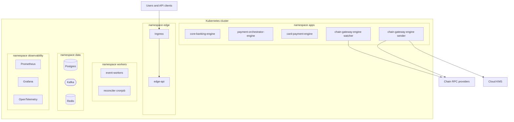

- **Deployables.** Four engines, `edge-api`, `event-workers` (with a reconciler cron job), and two simulators. The chain gateway runs as two Deployments from one image (`--role=watcher` and `--role=sender`) with separate service accounts and network policies.
- **State.** Postgres, Kafka, and Redis run in-cluster for the portfolio build. A real environment would use managed services.
- **Network policy.** Default deny. The sender's namespace-level policy allows only the KMS and broadcast RPC egress.

**Local environment (Docker Compose):** Postgres with one database per service, a Kafka-compatible broker (Redpanda is a lightweight option), Redis, Anvil as the local chain, Prometheus, Grafana, and an OpenTelemetry collector, plus the simulators.

## 12. Repository layout

```
Qixapay/
  services/
    core-banking-engine/            Java, Spring Boot
    payment-orchestrator-engine/    Java, Spring Boot
    card-payment-engine/            Java
    chain-gateway-engine/           Go
    edge-api/
    event-workers/
  simulators/
    bank-simulator/
    card-network-simulator/
  contracts/
    events/                         versioned event schemas
    openapi/                        service API specifications
  deploy/
    compose/                        local environment
    k8s/                            manifests or Helm charts
  tests/
    e2e/                            full-journey tests
  docs/
    architecture/                   diagrams and notes
    adr/                            architecture decision records
    runbooks/                       operational procedures
  Makefile
  README.md
```

## 13. Technology stack

| Concern | Choice | Notes |
|---|---|---|
| Ledger, orchestration, cards | Java with Spring Boot | Strong transactional and relational ecosystem |
| Chain gateway | Go | Node-ecosystem tooling, lightweight concurrency for scanners, small static binaries |
| Database | PostgreSQL | One database per service |
| Events | Kafka-compatible broker | Redpanda is a lightweight option locally |
| Cache and counters | Redis | Card velocity counters |
| Local chain | Anvil (Foundry) | Snapshots and reverts make reorg tests possible |
| Key custody | Cloud KMS or HSM | Local encrypted keystore in development only |
| Containers | Docker, Docker Compose | Local environment |
| Orchestration | Kubernetes | Manifests or Helm charts |
| Observability | Prometheus, Grafana, OpenTelemetry | Metrics, dashboards, traces |
| ISO 8583 | Open decision | See section 20 |
| Testing | JUnit with Testcontainers, Go test, property-based tests | Plus Anvil integration tests and end-to-end journeys |

## 14. Getting started

> **Planned.** The commands below describe the target developer experience and arrive with Slice 0. Until then this repository is documentation only.

**Prerequisites:** Docker, a current Java LTS, Go, Foundry (for Anvil and `cast`), and Make.

```bash
make up          # start Postgres, broker, Redis, Anvil, observability, simulators
make migrate     # apply database migrations for every service
make seed        # create demo organizations, accounts, and a test token
make test        # unit and integration tests
make e2e         # run the full-journey test described in the roadmap
make down        # stop everything
```

**Example `chain-gateway-engine` configuration (illustrative):**

```yaml
role: watcher            # or sender
chains:
  - chain_id: 31337      # local Anvil
    rpc_urls: ["http://anvil:8545"]
    tokens:
      - symbol: USDC
        address: "0xTEST_TOKEN_ADDRESS"
        decimals: 6
    max_reorg_depth: 64
    poll_interval: 2s
    finality_poll_interval: 30s
    credit_policy:
      tentative_below_usd: 100
      safe_below_usd: 10000
```

## 15. Testing strategy

| Level | What it proves |
|---|---|
| Unit | Reorg logic against an in-memory fake chain. State machines. Quote math |
| Property-based | Every journal entry balances. Replaying any request sequence never changes a balance twice |
| Concurrency | Two simultaneous spends cannot both pass a balance check |
| Integration | Each service against real Postgres and a broker through Testcontainers |
| Chain | Deposits, payouts, and **forced reorgs** against Anvil |
| Simulation | Bank chaos modes (delays, duplicates, out-of-order callbacks, unknown outcomes). Card network retries, reversals, and clearing mismatches |
| Crash | Kill a process between steps, restart, and assert no gaps and no duplicates |
| End to end | One test runs the whole journey and asserts that ledger, chain, and bank agree |
| Load | Card authorization latency at p95 and p99 |

**Forcing a reorg with Anvil:**

```bash
anvil &                                          # local chain

SNAP=$(cast rpc evm_snapshot | tr -d '"')        # 1. remember this point

# 2. send a test token transfer, mine blocks, let the indexer record it
cast rpc anvil_mine 2

cast rpc evm_revert $SNAP                        # 3. rewind: those blocks vanish
                                                 #    (the snapshot is consumed)
cast rpc anvil_mine 3                            # 4. mine a different history
```

Assert afterward that:

1. The transfer row from the orphaned block is gone.
2. The cursor is at or after the fork point on the new chain.
3. Exactly one `chain.reorgs.v1` event is in the outbox, listing the removed transfer.
4. If the transfer reappears on the new chain, it exists exactly once with the new block hash.

Make sure the replacement blocks really differ (different transactions or timestamps), otherwise they can end up with the same hashes and no reorg is visible. A revert consumes its snapshot, so take a fresh one before each additional reorg you simulate.

## 16. Conventions

| Item | Convention | Example |
|---|---|---|
| Service names | kebab-case, name states what the service owns | `core-banking-engine` |
| Databases | snake_case of the service | `core_banking`, `chain_gateway` |
| Kafka topics | `<domain>.<thing>.v<version>`, written only by the producer | `chain.transfers.v1` |
| Metrics | Prefixed with the service in snake_case | `chain_gateway_lag_blocks` |
| Log fields | Always `service`, `role` where relevant, `correlation_id` | |
| Java packages | `com.Qixapay.<service>.<module>` | `com.Qixapay.corebanking.ledger` |
| Go modules | Under the monorepo path | `.../services/chain-gateway-engine` |
| Public API paths | Name the capability, not the service | `/v1/payouts`, `/v1/quotes` |
| Internal API paths | `/internal/v1/...` and never exposed publicly | `/internal/v1/holds` |
| Money | Integer minor units or fixed-scale decimal, amounts as strings in JSON | `"250000000"` |
| Decisions | One architecture decision record per significant choice | `docs/adr/0001-service-boundaries.md` |

**Names to avoid in this codebase:** `Vault` (collides with HashiCorp Vault), `Beacon`, `Validator` and `Node` (Ethereum terms), `Bridge` (a different crypto concept), and `Transaction` as a service name (it already means a database transaction, a blockchain transaction, and a card transaction).

## 17. Roadmap

Build the platform as thin, demoable **vertical slices**, not as four separate projects.

- [ ] **Slice 0: Foundation.** Monorepo, Docker Compose environment, CI, the `contracts/` folder, shared logging with correlation IDs, and a skeleton `edge-api`.
- [ ] **Slice 1: Receive USDC.** `chain-gateway-engine` watcher, ledger, deposits, address derivation, one webhook. *Demo: send test USDC, watch the balance update, trigger a reorg and see it handled.*
- [ ] **Slice 2: Pay out.** Sender role, KMS (development keystore), payout orders, compliance screening, status events. *Demo: send a payout and watch it reach final.*
- [ ] **Slice 3: Cash out to naira.** `payment-orchestrator-engine`, quote engine, `bank-simulator`, treasury, the reconciler. *Demo: a full NGN withdrawal, including a simulated bank timeout.*
- [ ] **Slice 4: Spend on card.** `card-payment-engine`, `card-network-simulator`, clearing, capture, the float top-up loop.
- [ ] **Slice 5: Harden.** KYC tiers and limits, ops back-office, reporting, load tests, dashboards and alerts, and the final end-to-end test.

**Definition of done for every slice:** a demo script that runs from a clean checkout, automated tests including the failure cases listed in this document, diagrams updated, and an ADR for every non-obvious decision.

**Headline demo.** One recorded run of the full journey (receive, hold, cash out, pay out, card spend, top-up) that finishes with a reconciliation report showing chain, ledger, and bank in agreement.

## 18. Glossary

| Term | Meaning |
|---|---|
| **Authorization** | A card network's real-time request to approve a purchase. A promise of funds, not a movement of money |
| **Capture** | Turning a hold into a final ledger entry once the real amount is known |
| **Clearing** | The batch file listing actual card purchases, sent after authorization |
| **Corridor** | A payment route between two currencies or regions, such as NGN to USD |
| **ERC-20** | The standard interface for fungible tokens on Ethereum-compatible chains. USDC is an ERC-20 contract |
| **Finality** | The point at which a block can no longer be reverted |
| **Float** | Money the platform pre-positions so it can pay out or settle before it is replenished |
| **Fork point** | The last block that two competing chain histories agree on |
| **Hold** | Funds reserved for an in-flight transaction so they cannot be spent twice |
| **Idempotency key** | A client-chosen identifier that makes a repeated request safe |
| **ISO 8583** | The message standard used by card networks |
| **KYC** | Know your customer: identity verification |
| **KYT** | Know your transaction: risk screening of addresses and transfers |
| **MCC** | Merchant category code on a card transaction |
| **Nonce** | A sequence number for transactions from one blockchain address. Each must be used exactly once, in order |
| **Orphaned block** | A block that was part of a branch the network abandoned |
| **Outbox** | A table holding events to publish, written in the same transaction as the business change |
| **Reorg** | A reorganization: the network switches to a different branch of blocks |
| **RRN** | Retrieval reference number on a card message |
| **Saga** | A multi-step process where each step has a compensating undo |
| **Settlement** | The final exchange of funds, such as the card network being paid |
| **STAN** | System trace audit number on a card message |
| **Stablecoin** | A token designed to hold a stable value, such as one US dollar |
| **Travel Rule** | A requirement to pass sender and recipient information with certain transfers |

## 19. References

Links below were checked while writing this document. Titles without links are books.

**Tokens, events, and reading the chain**

- [EIP-20: ERC-20 Token Standard](https://ercs.ethereum.org/ERCS/erc-20)
- [Understand the ERC-20 token smart contract](https://ethereum.org/developers/tutorials/understand-the-erc-20-token-smart-contract/) (ethereum.org)
- [EIP-234: blockHash in JSON-RPC filter options](https://eips.ethereum.org/EIPS/eip-234)
- *Mastering Ethereum*, Antonopoulos and Wood

**Reorgs and finality**

- [Ethereum proof-of-stake attack and defense](https://ethereum.org/en/developers/docs/consensus-mechanisms/pos/attack-and-defense/)
- [Single slot finality](https://ethereum.org/en/roadmap/single-slot-finality/)
- [Casper the Friendly Finality Gadget](https://arxiv.org/abs/1710.09437)
- [Gasper](https://arxiv.org/abs/2003.03052)
- [Vitalik Buterin: single slot finality](https://notes.ethereum.org/@vbuterin/single_slot_finality)

**Testing**

- [Anvil reference](https://book.getfoundry.sh/reference/anvil/) (Foundry book)

**Ledgers, idempotency, and reliable messaging**

- [Accounting for Developers](https://www.moderntreasury.com/ebooks/accounting-for-developers) (Modern Treasury)
- [Accounting for Developers, Part III](https://www.moderntreasury.com/journal/accounting-for-developers-part-iii)
- [Designing robust and predictable APIs with idempotency](https://stripe.com/blog/idempotency) (Stripe)
- [Transactional outbox pattern](https://microservices.io/patterns/data/transactional-outbox) (Chris Richardson)
- [Life Beyond Distributed Transactions: An Apostate's Opinion](https://queue.acm.org/detail.cfm?id=3025012) (Pat Helland), and the [original paper](https://ics.uci.edu/~cs223/papers/cidr07p15)
- *Designing Data-Intensive Applications*, Martin Kleppmann
- *Microservices Patterns*, Chris Richardson

**Cards**

- [jPOS documentation](https://jpos.org/docs/welcome)
- [jPOS projects overview](https://jpos.org/docs/intro/projects)

**Stablecoin integration**

- [Circle: transfer USDC onchain](https://developers.circle.com/circle-mint/howtos/transfer-on-chain.md)
- [Circle: supported chains and currencies](https://developers.circle.com/circle-mint/references/supported-chains-and-currencies)

## 20. Open decisions, contributing and license

### Open decisions

Record each of these as an ADR when decided.

| Decision | Options and notes |
|---|---|
| First chain and token | An EVM test token with 6 decimals on Anvil first, then a public testnet. Real USDC and a second chain later |
| Credit policy thresholds | Illustrative values above. Set from a documented risk appetite |
| Event schema format | JSON Schema, Avro, or Protobuf. Pick one and enforce compatibility in CI |
| ISO 8583 library | jPOS is the standard Java option but is licensed under AGPLv3 with separate commercial licensing. Alternatives exist. Decide before any commercial use |
| Broker | Kafka or a Kafka-compatible broker such as Redpanda |
| Supporting component names | `edge-api`, `event-workers`, and the simulators are working names |
| Dashboard framework | Not yet chosen |
| Product name | Qixapay is a placeholder. Check existing trademarks and domains before publishing |
| Repository license | To be decided. Check the licenses of dependencies first |

### Contributing

The project is in the design stage. When implementation starts, every change should keep these rules:

- Only `core-banking-engine` writes the ledger.
- Only the sender role may reach the signer.
- Every state-changing endpoint is idempotent.
- Every external call has a timeout and a defined unknown-outcome path.
- Every non-obvious decision gets an ADR, and diagrams in this document are updated with the code.

### License

To be decided.